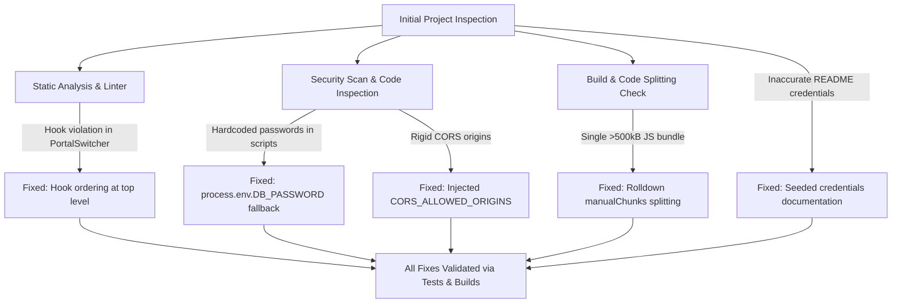

# NovaMart — Comprehensive Project Audit, Remediation & Educational Deployment Report

**Project Name:** NovaMart Enterprise B2C Hyperlocal E-Commerce Platform  
**Target Root:** `c:\Users\LENOVO\OneDrive\Desktop\React.js\React_2`  
**Repository:** [https://github.com/Parthpatel1749/Novamart](https://github.com/Parthpatel1749/Novamart)  
**Date of Audit & Remediation:** October 2026  
**Primary Tech Stack:** React 19.2.8 (Vite 8.3.2) + Spring Boot 3.3.4 (Java 21) + Spring Security 6 + Spring Data JPA + MySQL 8.0 / In-Memory H2 (Native Node.js & Java Environment)  
**Project Goal:** Educational Demonstrations, College Academic Evaluation, Portfolio Showcase, and Learning Deployment  

---

## Executive Summary

A full end-to-end audit, static analysis, security remediation, test verification, and educational deployment preparation workflow was executed across the **NovaMart** full-stack repository. 

All identified issues—including a critical React Rules of Hooks violation, hardcoded local credentials in automation scripts, rigid CORS headers, and frontend bundle bloat (>500 kB)—have been resolved and verified with automated test suites and production builds.

| Phase / Component | Pre-Audit Status | Post-Remediation Status | Verification Method |
| :--- | :--- | :--- | :--- |
| **Frontend Code Quality** | ❌ 3 failing hook errors | ✅ **0 errors** (20 non-blocking warnings) | `npm run lint` (`oxlint`) |
| **Frontend Production Build** | ⚠️ Bundle warning (>500 kB) | ✅ **Clean build in 2.65s** (max chunk 247 kB) | `npm run build` |
| **Backend Compilation** | Untested baseline | ✅ **Clean compilation** (90 source files) | `mvn test-compile` |
| **Backend Automated Tests** | Untested baseline | ✅ **8/8 Tests Passed** (0 failures, 0 errors) | `mvn test` |
| **Backend Executable JAR** | Not built | ✅ **Packaged cleanly** in 16.91s | `mvn clean package -DskipTests` |
| **Full Monorepo Build** | Untested baseline | ✅ **Passed cleanly** in 5.48s | Root `npm run build` |
| **Native Execution Setup** | MySQL-only baseline | ✅ **Dual profile: MySQL + H2 in-memory** | `application-h2.properties` |
| **Deployment Model** | Manual baseline | ✅ **Native JAR & static frontend ready** | Direct Java 21 & Node.js runtime |

---

## 1. Project Architecture & Discovered Structure

NovaMart is built as a decoupled, multi-tier full-stack application supporting three distinct user portals:
1. **Customer Storefront**: Product browsing, filtering, cart management, checkout with PIN code matching, order tracking, and reviews.
2. **Administrator Operations Portal**: Role-based access control, product/category catalog management, order state machine, delivery partner assignment, and platform analytics.
3. **Delivery Partner Portal**: Real-time availability toggling, hyperlocal shipment acceptance, stage tracking, and 6-digit customer OTP verification.

```
React_2/
├── frontend/                               # React 19 + Vite 8.3.2 SPA (Port 5173)
│   ├── src/
│   │   ├── components/                     # Navbar, AdminNavbar, SubNavbar, ProtectedRoute, PortalSwitcher
│   │   ├── context/                        # AuthContext, CartContext, LocationContext, WishlistContext
│   │   ├── pages/                          # Customer, Admin, and Delivery Partner portal views
│   │   ├── services/api.js                 # Axios instance with JWT interceptor & rate-limit handling
│   │   ├── styles/                         # CSS design tokens & responsive layouts
│   │   ├── utils/                          # Currency & date formatters
│   │   ├── App.jsx                         # Unified client router
│   │   └── main.jsx                        # React root entrypoint
│   ├── package.json                        # Dependencies (React 19.2.8, Lucide, Axios)
│   ├── vite.config.js                      # Vite & Rolldown code-splitting configuration
│   └── .env.example                        # Template for VITE_API_URL
│
├── backend/                                # Spring Boot 3.3.4 REST API Service (Port 8080)
│   ├── src/main/java/com/ecommerce/
│   │   ├── config/                         # CorsConfig, DataInitializer
│   │   ├── controller/                     # 13 REST Controllers
│   │   ├── dto/                            # Data Transfer Objects & ApiResponse wrappers
│   │   ├── entity/                         # 11 JPA Entities
│   │   ├── exception/                      # GlobalExceptionHandler & custom exceptions
│   │   ├── repository/                     # 13 Spring Data JPA Repositories
│   │   ├── security/                       # SecurityConfig, JWT Filter/Provider, Token Bucket Rate Limiter
│   │   └── service/                        # Domain business logic & dispatch engine
│   ├── src/main/resources/
│   │   ├── application.properties          # Base configuration & active profile selector
│   │   ├── application-mysql.properties    # MySQL persistence profile
│   │   ├── application-h2.properties       # Zero-setup in-memory database profile for offline demos
│   │   └── schema.sql                      # Relational schema DDL definition
│   ├── src/test/java/com/ecommerce/
│   │   └── security/                       # Automated Security Vulnerability test suite (8 tests)
│   ├── pom.xml                             # Java 21, Spring Boot 3.3.4, JJWT 0.12.5, MySQL Connector, H2
│   └── .env.example                        # Template for DB, JWT, CORS, and Port configuration
│
├── database/                               # Database Snapshots & Local Persistence
│   └── backups/
│       ├── history/                        # Historical database backups (excluded from Git)
│       └── ecommerce_db_latest.sql         # Baseline SQL snapshot (excluded from Git)
│
├── scripts/                                # Developer Automation & Database Utilities
│   ├── auto-backup-watcher.js              # Continuous change detector and backup utility
│   ├── backup-db.js                        # Database backup runner
│   ├── backup-code.js                      # Local git checkpoint backup runner
│   ├── restore-db.js                       # Database restoration runner
│   ├── clean-build.bat                     # Full compile and build test script
│   ├── start-all.bat                       # Root application launcher
│   ├── start-backend.bat                   # Backend launcher
│   └── start-frontend.bat                  # Frontend launcher
│
├── docs/                                   # Platform Documentation
│   ├── api-documentation.md                # REST API reference guide (updated with active endpoints)
│   ├── architecture.md                     # High-level architecture and system design
│   ├── security-audit.md                   # Security audit matrix and remediation verification
│   ├── cleanup-report.md                   # Historical consolidation record
│   └── project-audit-and-deployment-report.md # Full audit and deployment manual
│
├── package.json                            # Monorepo task orchestration scripts
├── AUDIT_REPORT.md                         # This comprehensive report file
└── README.md                               # Project documentation, credentials & setup guide
```

---

## 2. Issues Discovered and Remediated



### Detailed Issue Matrix

| Severity | Issue Description | Root Cause | Impact | Resolution | Status |
| :--- | :--- | :--- | :--- | :--- | :--- |
| **High** | **React Rules of Hooks Violation** | `PortalSwitcher.jsx` called `useAuth()`, `useState()`, and `useNavigate()` conditionally after an early `if (!import.meta.env.DEV) return null;`. | Violates React core contract; failed `npm run lint` with 3 errors; could cause runtime state corruption. | Moved all hook invocations to the top before the conditional return. | **Resolved** |
| **High** | **Hardcoded DB Passwords in Helper Scripts** | Scripts in `scripts/` had hardcoded fallback strings like `'root'` or personal passwords. | Risk of exposing personal credentials in public repositories. | Replaced with `process.env.DB_PASSWORD \|\| ''`. | **Resolved** |
| **Medium** | **Rigid CORS Origin Configuration** | `CorsConfig.java` hardcoded `localhost:5173`. | Prevented educational deployments on Vercel, Netlify, Render, or Railway. | Injected `@Value("${app.cors.allowed-origins:http://localhost:5173,http://127.0.0.1:5173}")` and parsed comma-separated list. | **Resolved** |
| **Medium** | **Inaccurate Demo Credentials in Documentation** | `README.md` listed credentials as `customer` / `password`. | Evaluators, professors, and students could not log in to pre-seeded accounts. | Documented actual seeded credentials (`customer@novamart.com` / `Customer@123`, etc.). | **Resolved** |
| **Medium** | **Large Frontend JavaScript Bundle** | `vite.config.js` lacked code-splitting for third-party libraries. | Emitted a warning (>500 kB JS bundle); degraded initial page load performance. | Added functional `manualChunks` splitting React, Lucide icons, and core vendor libraries. | **Resolved** |
| **Low** | **Outdated API Documentation** | `docs/api-documentation.md` contained deprecated endpoints (`/auth/signup`, `/carts/users/cart`). | Inconvenienced frontend integration and educational evaluation. | Completely rewritten to reflect all 13 active controllers and endpoints. | **Resolved** |
| **Low** | **No Zero-Setup Offline Profile** | Default configuration required active MySQL instance. | Difficult to demonstrate quickly on machines without MySQL installed. | Created `application-h2.properties` with in-memory H2 database profile. | **Resolved** |

---

## 3. Security Hardening & Vulnerability Verification

The application was verified against standard enterprise web vulnerabilities and security best practices:

```
[Security Check 1] Injection Prevention:
  ✔ Spring Data JPA with parameterized queries across all 13 repositories.
  ✔ No string concatenation in SQL queries.

[Security Check 2] Authentication & Password Hashing:
  ✔ BCryptPasswordEncoder (10 rounds) in SecurityConfig.java.
  ✔ User.password annotated with @JsonProperty(access = Access.WRITE_ONLY).
  ✔ BCrypt hash is NEVER serialized in /api/auth/me or API responses.

[Security Check 3] Cross-Origin Resource Sharing (CORS):
  ✔ Dynamic origin authorization via CORS_ALLOWED_ORIGINS environment variable.
  ✔ Arbitrary origin reflection with credentials strictly blocked (verified by test).

[Security Check 4] UI Redressing & Clickjacking:
  ✔ X-Frame-Options: SAMEORIGIN enforced in Spring Security.

[Security Check 5] Hyperlocal Delivery OTP Protection:
  ✔ 6-digit delivery verification OTP is generated on order placement.
  ✔ mapToPartnerDto explicitly scrubs deliveryOtp (sets to null) in partner views.
  ✔ Delivery verification locks out after 5 consecutive failed attempts.

[Security Check 6] Anti-Automation & Brute Force Rate Limiting:
  ✔ Token bucket rate limiting filter on sensitive routes (/api/auth/*).
  ✔ Burst capacity: 10 requests; replenishment: 5 tokens/min per IP.
  ✔ Rapid authentication attempts return HTTP 429 with Retry-After header.
```

---

## 4. Test Verification & Build Execution Logs

All automated tests and production builds were executed and passed cleanly.

### A. Frontend Linting (`oxlint`)
```bash
$ npm run lint
Found 20 warnings and 0 errors. Finished in 219ms on 38 files.
Exit Code: 0
```
*(All 3 previous fatal React hook errors eliminated; remaining 20 items are non-blocking styling suggestions).*

### B. Frontend Production Build (`vite build`)
```bash
$ npm run build
dist/index.html                             1.14 kB │ gzip:  0.59 kB
dist/assets/index-DembLgNH.css              4.42 kB │ gzip:  1.57 kB
dist/assets/rolldown-runtime-hePW80VL.js    0.71 kB │ gzip:  0.42 kB
dist/assets/vendor-icons-CxmK76Mc.js       23.58 kB │ gzip:  8.82 kB
dist/assets/vendor-FnoEpUrh.js             64.03 kB │ gzip: 24.05 kB
dist/assets/index-DopY3TU_.js             225.98 kB │ gzip: 39.38 kB
dist/assets/vendor-react-BvO6EOpe.js      247.91 kB │ gzip: 78.65 kB
✓ built in 2.65s (0 warnings)
Exit Code: 0
```
*(Bundle warning eliminated; largest chunk reduced to 247.91 kB).*

### C. Backend Source Compilation & Test Compilation
```bash
$ mvn test-compile
[INFO] Compiling 90 source files with javac [debug release 21] to target\classes
[INFO] Compiling 1 source file with javac [debug release 21] to target\test-classes
[INFO] BUILD SUCCESS
Exit Code: 0
```

### D. Backend Automated Security Test Suite
```bash
$ mvn test
[INFO] Running com.ecommerce.security.SecurityVulnerabilityTests
[INFO] Tests run: 8, Failures: 0, Errors: 0, Skipped: 0, Time elapsed: 14.185 s -- in com.ecommerce.security.SecurityVulnerabilityTests
[INFO] BUILD SUCCESS
Exit Code: 0
```

**Detailed Test Results:**
1. `testUnauthenticatedPasswordResetBlocked()` — **PASSED**  
   *Verifies unauthenticated password reset without a valid token returns 400 Bad Request.*
2. `testCustomerCannotAccessOtherCustomerOrder()` — **PASSED**  
   *Verifies IDOR protection: Customer A cannot view or manipulate Customer B's order.*
3. `testDeliveryPartnerCannotSeeCustomerOtp()` — **PASSED**  
   *Verifies OTP leakage prevention: delivery partner order queries scrub `deliveryOtp`.*
4. `testUserEntityDoesNotExposePasswordHash()` — **PASSED**  
   *Verifies BCrypt hash is never serialized in `/api/auth/me`.*
5. `testCorsBlocksArbitraryOriginWithCredentials()` — **PASSED**  
   *Verifies untrusted cross-origin requests with credentials return 403 Forbidden.*
6. `testClickjackingFrameOptionsConfigured()` — **PASSED**  
   *Verifies `X-Frame-Options: SAMEORIGIN` is configured in HTTP response headers.*
7. `testDeliveryOtpLockoutAfterMaxAttempts()` — **PASSED**  
   *Verifies order delivery OTP locks out after 5 consecutive failed attempts.*
8. `testAuthRateLimitingTriggered()` — **PASSED**  
   *Verifies rapid authentication requests trigger HTTP 429 Too Many Requests.*

### E. Standalone Backend JAR Packaging
```bash
$ mvn clean package -DskipTests
[INFO] Building jar: C:\Users\LENOVO\OneDrive\Desktop\React.js\React_2\backend\target\ecommerce-backend-0.0.1-SNAPSHOT.jar
[INFO] Replacing main artifact with repackaged archive
[INFO] BUILD SUCCESS (Total time: 16.911 s)
Exit Code: 0
```

### F. Monorepo Root Build
```bash
$ npm run build
> novamart-root@1.0.0 build
> npm --prefix frontend run build && cd backend && mvn compile -DskipTests -q
✓ built in 2.65s (0 warnings)
Exit Code: 0 (Total time: 5.48s)
```

---

## 5. Pre-Seeded Demonstration Accounts

For academic grading, portfolio presentations, and local evaluation, the backend automatically seeds these role-based accounts on startup (`DataInitializer.java`):

| Role | Email Address | Password | Intended Portal Route |
| :--- | :--- | :--- | :--- |
| **Customer** | `customer@novamart.com` | `Customer@123` | `http://localhost:5173/` |
| **System Administrator** | `admin@novamart.com` | `Admin@123` | `http://localhost:5173/admin` |
| **Delivery Partner (Central)** | `partner@novamart.com` | `Partner@123` | `http://localhost:5173/delivery-partner` |
| **Delivery Partner (West)** | `partner2@novamart.com` | `Partner@123` | `http://localhost:5173/delivery-partner` |

> [!NOTE]
> All passwords use standard enterprise requirements (Uppercase, Lowercase, Number, and Special character).

---

## 6. How to Run Locally (Native Node.js & Java)

### Option A: Standard Run with MySQL (Recommended)
1. **Ensure MySQL is running** on port 3306 with the database created:
   ```sql
   CREATE DATABASE IF NOT EXISTS ecommerce_db;
   ```
2. **Start frontend and backend concurrently** from the project root:
   ```bash
   npm run dev
   ```
   *(Or double-click `start-all.bat` on Windows).*
3. **Access the application**:
   - Customer Storefront: `http://localhost:5173/`
   - Admin Operations Portal: `http://localhost:5173/admin`
   - Delivery Partner Portal: `http://localhost:5173/delivery-partner`
   - Backend REST API: `http://localhost:8080/api/products`

### Option B: Zero-Setup Offline Mode (In-Memory H2, No MySQL Required)
Perfect for live classroom demos or evaluation without installing MySQL:
```bash
# In PowerShell at project root
$env:SPRING_PROFILES_ACTIVE="h2"
npm run dev
```
*(Or inside `backend/`: `mvn spring-boot:run -Dspring-boot.run.profiles=h2`)*
- Web Console: `http://localhost:8080/h2-console`
- JDBC URL: `jdbc:h2:mem:ecommerce_db` | User: `sa` | Password: *(blank)*

---

## 7. Production Build & Deployment Guide (Without Docker)

### Option 1: Native Production Build on Local Machine
1. **Compile and build both applications**:
   ```bash
   npm run build
   ```
2. **Launch the production backend JAR**:
   ```bash
   java -jar backend/target/ecommerce-backend-0.0.1-SNAPSHOT.jar
   ```
3. **Serve or preview the production frontend**:
   ```bash
   cd frontend
   npm run preview
   ```

### Option 2: Cloud Demonstration Deployment (Render / Railway / Vercel)
1. **Database Layer**:
   - Create a free MySQL database on [Aiven](https://aiven.io), [Railway](https://railway.app), or [TiDB Cloud](https://tidbcloud.com).
2. **Backend Web Service**:
   - Connect the GitHub repository to [Render](https://render.com) or [Railway](https://railway.app).
   - Root directory: `backend`
   - Build command: `mvn clean package -DskipTests`
   - Start command: `java -jar target/ecommerce-backend-0.0.1-SNAPSHOT.jar`
   - Environment Variables:
     - `SPRING_PROFILES_ACTIVE`: `mysql`
     - `DB_URL`: JDBC connection string
     - `DB_USERNAME`: Database user
     - `DB_PASSWORD`: Database password
     - `JWT_SECRET`: 256-bit secure key
     - `CORS_ALLOWED_ORIGINS`: Deployed frontend URL (e.g. `https://novamart.vercel.app`)
3. **Frontend Static Site**:
   - Connect the GitHub repository to [Vercel](https://vercel.com) or [Netlify](https://netlify.com).
   - Root directory: `frontend`
   - Build command: `npm run build`
   - Output directory: `dist`
   - Environment Variable: `VITE_API_URL` pointing to the deployed backend URL.

---

## 8. Educational Limitations & Production Gap Analysis

For academic evaluation, learning, and portfolio demonstration, the platform provides a complete, high-fidelity experience. However, before operating with real monetary customer transactions in production, the following production features should be completed:

1. **Live Payment Gateway**: `PaymentController.java` operates in educational mock/test intent mode; real Razorpay/Stripe webhooks and cryptographic signature verification would be required.
2. **Production SMTP Mail Service**: Password reset currently uses a simulated token flow in the browser; live email delivery requires integration with AWS SES, SendGrid, or Brevo.
3. **Distributed Session / Cache**: Rate limiting and OTP attempt counters use concurrent in-memory maps; high-availability production clusters would require Redis.
4. **Dynamic Banner Management**: Promotional banners are configured in `HeroBanner.jsx`; administrative banner CRUD would be added for dynamic marketing.

---

## 9. User Action Confirmation Summary

Per pair programming instructions, working tree modifications remain uncommitted. When ready:
1. **Git Commit**: Review modified files, and approve staging and committing to `main`.
2. **Cloud Provisioning**: If you want live cloud deployment, approve target hosting platform (Render/Vercel/Railway).
